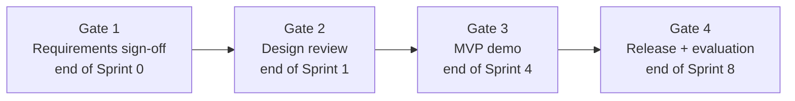
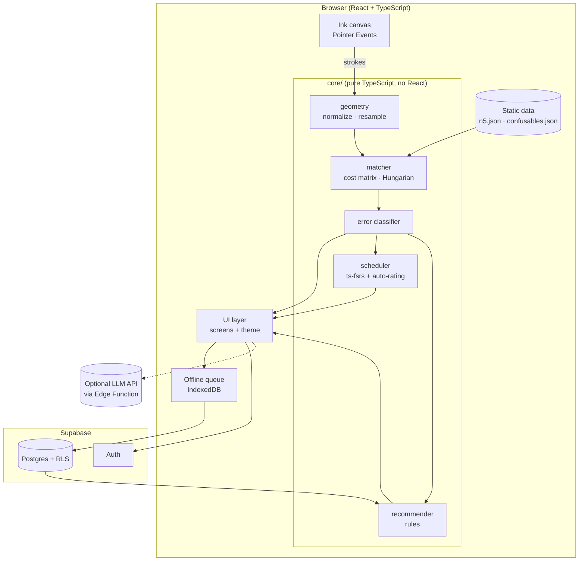
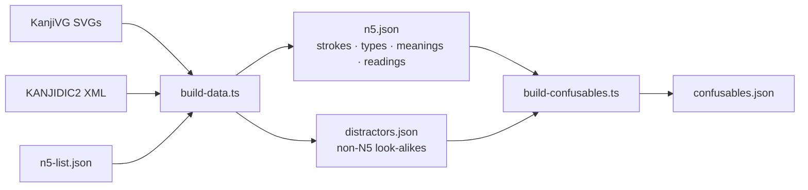
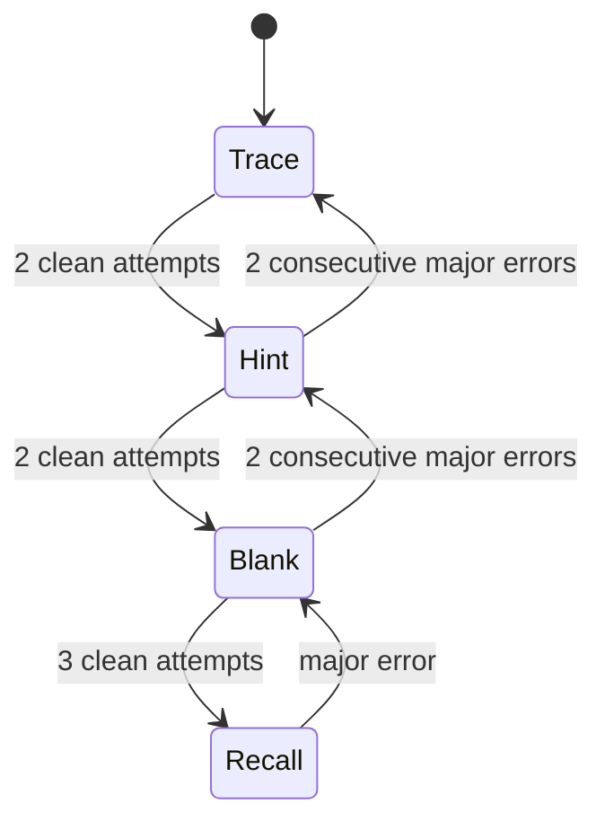

# 筆 Fude — Smart Kanji Learning System
## Implementation Plan (v1.0 — JLPT N5 scope)

| | |
|---|---|
| **Project** | Smart Kanji Learning System — a confusion-aware, pen-first kanji learning web app |
| **Team** | Darshan Nair (123B1C066), Vaidavi Naik (123B1C058) |
| **Guide** | Prof. Geetanjali Zambre |
| **Document version** | 1.0 — 2026-10-09 |
| **Scope** | JLPT N5 kanji only (~80 characters) |
| **Working name** | **Fude (筆, "brush")**. Placeholder; rename freely. |

---

## Table of Contents

1. [Vision and Scope](#1-vision-and-scope)
2. [SDLC Model and Team Workflow](#2-sdlc-model-and-team-workflow)
3. [Phase 1 — Requirements](#3-phase-1--requirements)
4. [Phase 2 — System Design](#4-phase-2--system-design)
5. [Phase 3 — UI/UX Design (Japanese Theme)](#5-phase-3--uiux-design-japanese-theme)
6. [Phase 4 — Implementation (Sprint Plan)](#6-phase-4--implementation-sprint-plan)
7. [Phase 5 — Testing and Evaluation](#7-phase-5--testing-and-evaluation)
8. [Phase 6 — Deployment](#8-phase-6--deployment)
9. [Phase 7 — Maintenance and Future Scope](#9-phase-7--maintenance-and-future-scope)
10. [Risks and Mitigations](#10-risks-and-mitigations)
11. [Appendices](#11-appendices)

---

## 1. Vision and Scope

### 1.1 Problem
Kanji learners make mistakes of very different kinds: wrong stroke order, reversed strokes, bad proportions, or writing a look-alike character entirely. Existing tools either grade the final shape (right or wrong) or schedule reviews. **They don't explain *why* an attempt is wrong**, and they don't adapt practice to that reason.

### 1.2 Solution
A web app where learners write kanji with a **pen (graphics tablet, stylus or touch; a mouse also works)**. Each attempt goes through a deterministic stroke-matching engine that:

1. **Classifies the error type**: stroke order, direction, count, proportion, position, stroke ending, or confusion with another kanji.
2. **Updates a per-learner model**: error-type weaknesses plus a personal *confusion graph*.
3. **Adapts practice**: the review schedule is graded automatically (FSRS), the guide fades in steps, and targeted drills (e.g. 右 vs 左) are recommended.

### 1.3 Design principles
- **No model training.** Recognition and error analysis use geometry against KanjiVG reference strokes. The results can be explained and tested, and they behave the same every time.
- **The target is always known.** In a learning app the prompt says which kanji the learner should write, so we *verify* against a known target instead of *recognizing* an unknown one.
- **Logic is kept separate from the UI.** All analysis lives in a framework-free `core/` package with full unit-test coverage.
- **Works without a tablet.** Pressure and tilt are optional extras; every core feature works with a mouse or a finger.

### 1.4 Scope

| In scope (v1) | Out of scope (v1) |
|---|---|
| ~80 JLPT N5 kanji | N4 and above (planned in §9) |
| Pen/stylus/touch/mouse handwriting capture | Free-form recognition of arbitrary kanji |
| Stroke-level error classification (7 types) | CNN/deep-learning models |
| Confusion detection against look-alike sets | Hiragana/katakana practice |
| FSRS spaced repetition with automatic grading | Vocabulary/grammar lessons |
| Rule-based personalized recommendations | Native mobile apps (the web app is responsive) |
| Progress dashboard | Social features, leaderboards |
| Email/OAuth login, cloud sync | Payments |
| *Optional:* LLM-generated mnemonics and example sentences | Full brush-calligraphy simulation |

---

## 2. SDLC Model and Team Workflow

### 2.1 Model: incremental-iterative (Agile/Scrum-lite)
We follow the classic SDLC phases (**Requirements → Design → Implementation → Testing → Deployment → Maintenance**), delivered over **one-week sprints**. Each sprint produces a working, tested increment. There are **four phase gates**, each reviewed with the project guide:



### 2.2 Roles (two-person team)

| Area | Owner | Reviewer |
|---|---|---|
| `core/` engine (geometry, matcher, error classifier, synthetic tests) | Darshan | Vaidavi |
| Frontend UI, theme, canvas UX, accessibility | Vaidavi | Darshan |
| Data pipeline (KanjiVG / KANJIDIC2 → JSON) | Darshan | Vaidavi |
| Backend (Supabase schema, RLS, sync) | Vaidavi | Darshan |
| Scheduler and recommender | Shared | — |
| Documentation and evaluation report | Shared | Guide |

*(Swap these as you prefer. The rule is that **every PR is reviewed by the other person**.)*

### 2.3 Sprint ceremonies (lightweight)
- **Sprint planning (Mon, 30 min):** pull stories from the backlog into the sprint and estimate them in story points (1/2/3/5).
- **Async standup (daily):** three lines in the team chat: done / doing / blocked.
- **Sprint review (Sun, 30 min):** demo the increment; record a short screen capture for the guide.
- **Retrospective (Sun, 15 min):** one thing to keep, one to change.

### 2.4 Tooling
| Concern | Tool |
|---|---|
| Version control | Git + GitHub (private repo) |
| Backlog / board | GitHub Projects (Kanban: Backlog → Sprint → In Progress → Review → Done) |
| Branching | `main` (always deployable) ← `develop` ← `feat/*`, `fix/*`, `chore/*` |
| Commits | [Conventional Commits](https://www.conventionalcommits.org/) (`feat(matcher): detect reversed strokes`) |
| CI | GitHub Actions: lint → typecheck → unit tests → build, on every PR |
| CD | Vercel preview deploy per PR; production deploy on merge to `main` |
| Issue templates | Bug report, user story, tech task |

### 2.5 Definition of Done (applies to every story)
- [ ] Code merged to `develop` through a reviewed PR
- [ ] CI is green (lint, typecheck, tests, build)
- [ ] New `core/` logic has unit tests (target ≥ 90% line coverage for `core/`)
- [ ] UI works in light and dark themes, and at phone width (360 px)
- [ ] Works with mouse **and** pen/touch input
- [ ] Acceptance criteria in the story are demonstrably met
- [ ] Docs/README updated if behaviour or setup changed

---

## 3. Phase 1 — Requirements

### 3.1 Personas
- **Aiko-chan the beginner:** has just finished kana and is starting N5 kanji. Writes with a phone stylus or a mouse. Needs heavy guidance.
- **Rahul the self-learner:** owns a cheap pen tablet and studies 20 minutes a day. Knows some kanji but keeps mixing up look-alikes.
- **Prof. evaluator:** wants measurable evidence that the system detects errors accurately and improves learning.

### 3.2 Functional requirements

| ID | Requirement | Priority |
|---|---|---|
| **FR-01** | User can sign up / log in (email magic link or Google OAuth) | Must |
| **FR-02** | User can browse the N5 kanji library with meaning, on'yomi, kun'yomi, stroke count, and example words | Must |
| **FR-03** | User can watch an animated stroke-order demonstration for any kanji | Must |
| **FR-04** | User can write a kanji on a practice canvas using pen, touch or mouse; pressure and tilt are captured when available | Must |
| **FR-05** | System analyses an attempt and reports per-stroke errors of these types: **order, direction, count, proportion, position, ending, confusion** | Must |
| **FR-06** | System shows feedback visually: wrong strokes highlighted, plus a replay overlay of the user's strokes against the reference | Must |
| **FR-07** | System optionally checks each stroke live, as soon as it is drawn (toggle) | Should |
| **FR-08** | System schedules reviews using FSRS, with the rating **derived automatically** from the attempt (with a manual override) | Must |
| **FR-09** | Guide level fades per kanji: Trace → Hint → Blank grid → Recall-from-prompt | Must |
| **FR-10** | System maintains a per-user error-type profile and confusion graph | Must |
| **FR-11** | System recommends targeted activities (confusion drills, stroke-order replay, ending practice) based on the profile | Must |
| **FR-12** | User can run a **confusion drill**, writing two look-alike kanji alternately | Should |
| **FR-13** | Dashboard shows mastery per kanji, error-type breakdown, confusion graph, and review forecast | Should |
| **FR-14** | All attempts (raw strokes + analysis) are stored for evaluation and research export (CSV/JSON) | Must |
| **FR-15** | Settings: handedness, live-check toggle, daily new-kanji limit, theme (light/dark/system), furigana/romaji toggle | Should |
| **FR-16** | *(Optional)* LLM-generated mnemonic and example sentence per kanji, cached | Could |

### 3.3 Non-functional requirements

| ID | Requirement | Target |
|---|---|---|
| **NFR-01 Performance** | Analysis of one attempt (target + up to 10 look-alike candidates) | p95 < 30 ms on a mid-range laptop |
| **NFR-02 Input latency** | Ink appears under the pen | < 16 ms (one frame); `getCoalescedEvents()` used |
| **NFR-03 Accuracy** | Error detection on the generated-mistake test set (§7.3) | F1 ≥ 0.90 for order/direction/count; ≥ 0.80 for proportion/position; confusion top-1 ≥ 0.85 |
| **NFR-04 Availability** | Practice keeps working during brief network loss | Attempts queued locally, synced later |
| **NFR-05 Security** | Users can only read/write their own data | Supabase Row-Level Security on every table |
| **NFR-06 Accessibility** | WCAG 2.1 AA contrast, keyboard-navigable non-canvas UI, `prefers-reduced-motion` respected | Lighthouse a11y ≥ 95 |
| **NFR-07 Compatibility** | Chrome/Edge (Windows + Wacom/XP-Pen/Huion), Safari iPad + Apple Pencil, Chrome Android | Manual test matrix §7.6 |
| **NFR-08 Maintainability** | `core/` has no UI or network dependencies; thresholds live in config | Code review checklist |
| **NFR-09 Licensing** | KanjiVG (CC BY-SA 3.0) and KANJIDIC2 (CC BY-SA 4.0) attributed; derived data shared under the same licence | About page + `data/LICENSE` |

### 3.4 Key user stories (initial backlog)

| # | Story | Acceptance criteria |
|---|---|---|
| US-1 | *As a learner, I want to write 右 and be told exactly which stroke I got wrong, so I can fix it.* | The wrong stroke is highlighted in vermilion; the message names the error type ("Stroke 1 should come before stroke 2") |
| US-2 | *As a learner who confuses 右/左, I want the app to notice and drill me on the pair.* | After ≥2 confusion events in 7 days, a 右⇄左 drill appears on Home |
| US-3 | *As a learner, I don't want to rate myself after every card.* | FSRS rating is computed automatically; the user can tap to override |
| US-4 | *As a learner with no tablet, I still want to practise.* | All FR-04–FR-13 work with a mouse; ending checks are skipped silently |
| US-5 | *As the evaluator, I want to export all attempts.* | Settings → Export gives JSON/CSV including raw strokes and analysis |

**Gate 1 deliverables:** this document's §1–3 reviewed and signed off by the guide; GitHub board populated with the backlog.

---

## 4. Phase 2 — System Design

### 4.1 Architecture



**All analysis runs in the browser**, so no ML server is needed, feedback is instant and hosting is free-tier friendly. Supabase handles auth and storage only.

### 4.2 Tech stack

| Layer | Choice | Why |
|---|---|---|
| Language | TypeScript (strict) | One language for core, UI and scripts |
| Build | Vite | Fast dev server, simple config |
| UI | React 18 + React Router | Familiar, large ecosystem |
| Styling | Tailwind CSS + CSS variables for theme tokens | Fast iteration; tokens give the Japanese palette and dark mode |
| State | Zustand | Minimal boilerplate |
| Canvas | Native `<canvas>` + Pointer Events | Pressure/tilt/coalesced events; no library needed |
| Scheduling | [`ts-fsrs`](https://github.com/open-spaced-repetition/ts-fsrs) | Maintained FSRS implementation |
| Backend | Supabase (Auth + Postgres + RLS + Edge Functions) | No custom server; free tier |
| Offline | `idb-keyval` | Small IndexedDB wrapper for the attempt queue |
| Tests | Vitest (unit), Testing Library (components), Playwright (E2E) | Fast, TS-native |
| Charts | Recharts (dashboard) | Simple React charts |
| Hosting | Vercel | Preview deploys per PR |

### 4.3 Repository structure

```
fude/
├── scripts/
│   ├── build-data.ts          # KanjiVG + KANJIDIC2 → public/data/*.json
│   └── build-confusables.ts   # similarity computation → confusables.json
├── data/
│   ├── raw/                   # downloaded sources (git-ignored)
│   ├── n5-list.json           # frozen list of N5 kanji (source of truth for scope)
│   └── LICENSE                # CC BY-SA attribution for derived data
├── public/data/               # generated: n5.json, confusables.json, distractors.json
├── src/
│   ├── core/                  # PURE TS: no React, no fetch
│   │   ├── types.ts           # Stroke, Point, Attempt, Analysis, ErrorType…
│   │   ├── geometry/          # normalize, resample, length, centroid, direction
│   │   ├── matcher/           # cost matrix, hungarian, match()
│   │   ├── classifier/        # one file per error type + classify()
│   │   ├── synth/             # synthetic error injection (tests + evaluation)
│   │   ├── scheduler/         # autoRate(), FSRS wrapper, guide-level progression
│   │   ├── recommender/       # rules → Recommendation[]
│   │   └── config.ts          # all thresholds in one place
│   ├── features/
│   │   ├── auth/
│   │   ├── home/              # 今日 Today: queue + recommendations
│   │   ├── library/           # 漢字帳 kanji grid + detail
│   │   ├── learn/             # new-kanji introduction
│   │   ├── practice/          # 練習 canvas, feedback, replay
│   │   ├── review/            # 復習 FSRS session
│   │   ├── drill/             # confusion drills
│   │   ├── progress/          # 成績 dashboard
│   │   └── settings/
│   ├── ui/                    # themed primitives: Button, Card, Hanko, InkCanvas, GenkoGrid…
│   ├── theme/                 # tokens.css, fonts, patterns (SVG)
│   ├── lib/                   # supabase client, sync queue, export
│   └── main.tsx
├── supabase/migrations/       # SQL schema + RLS policies
├── tests/
│   ├── e2e/                   # Playwright
│   └── fixtures/              # recorded real pen attempts (JSON)
└── docs/                      # ADRs, evaluation report, user manual
```

### 4.4 Data pipeline (run once at build time)



For each N5 kanji, **`n5.json`** stores:
```ts
{
  char: "右",
  strokes: [            // from KanjiVG, normalized to a 0–1 box, resampled to 32 points
    { points: [[x, y], ...], type: "㇒", ending: "harai" },
    ...
  ],
  strokeCount: 5,
  meanings: ["right"],
  onyomi: ["ウ", "ユウ"],
  kunyomi: ["みぎ"],
  examples: [{ word: "右手", reading: "みぎて", meaning: "right hand" }],  // curated, ~3 per kanji
  components: ["口", "𠂇"]   // from KanjiVG groups
}
```

- **Stroke endings:** the build script maps KanjiVG `kvg:type` to an expected ending: hooked types → `hane`, ㇒ ㇏ → `harai`, ㇐ ㇑ ㇔ → `tome`. Ambiguous types map to `null`, which means "don't check".
- **`distractors.json`:** look-alike kanji *outside* N5 (e.g. 末, 未, 牛, 犬, 目). They are used only as wrong-answer candidates for confusion detection and are never taught.
- **Confusables:** for each N5 kanji, the 5–10 nearest kanji by a similarity score:
  `sim = 0.5·componentOverlap + 0.3·(1 − strokeTypeEditDistance_norm) + 0.2·(1 − |Δstrokes|/max)`.
  The list is then manually reviewed and seeded with the known pairs in Appendix B.

### 4.5 Core data types

```ts
type Point  = { x: number; y: number; t: number; p?: number; tiltX?: number; tiltY?: number };
type Stroke = Point[];
type Attempt = { target: string; strokes: Stroke[]; device: "pen" | "touch" | "mouse"; startedAt: number };

type ErrorType = "order" | "direction" | "count" | "proportion" | "position" | "ending" | "confusion";
type Severity  = "minor" | "major";

type StrokeError = { type: ErrorType; severity: Severity; refStroke?: number; userStroke?: number; message: string };

type Analysis = {
  target: string;
  bestMatch: string;           // == target unless a confusion was detected
  score: number;               // 0–1 shape similarity to target
  mapping: number[];           // userStroke index → refStroke index (-1 = extra)
  errors: StrokeError[];
  timing: { totalMs: number; hesitationMs: number; meanStrokeMs: number };
};
```

### 4.6 The matching engine (core algorithm)

**Step 1: Normalize.** Translate and scale the attempt into a unit square using its bounding box, keeping the aspect ratio and centring it. Remove points closer together than ε (jitter) and drop strokes shorter than 2% of the box (accidental taps).

**Step 2: Resample.** Resample each stroke to N = 32 equally spaced points.

**Step 3: Cost matrix.** For user stroke *i* and reference stroke *j*:
```
fwd(i,j) = mean distance between corresponding points
rev(i,j) = same, with user stroke i reversed
cost(i,j) = min(fwd, rev) + λ · |angle(i) − angle(j)|
```

**Step 4: Assignment.** Run the Hungarian algorithm on the (padded) cost matrix to get the best one-to-one pairing of user strokes to reference strokes.

**Step 5: Classify errors** using the rules below. Every threshold lives in `core/config.ts` and is tuned on the generated-mistake set.

| Error | Rule |
|---|---|
| **count** | `user.length ≠ ref.length`. If one user stroke is close to the joined path of two consecutive reference strokes, report *merged*; if two user strokes join into one reference stroke, report *split* |
| **order** | Pairing is not in sequence: user stroke *k* is paired with reference *j* ≠ expected. Report the first displaced stroke. Major if an inner component was written before the strokes around it, otherwise minor |
| **direction** | `rev(i,j) < fwd(i,j) − τ_dir` for a paired stroke |
| **proportion** | The length ratio of paired strokes differs from the reference ratio by more than τ_prop. Checked specifically for stroke pairs flagged in confusables (e.g. 土/士: top vs bottom horizontal) |
| **position** | A paired stroke's centre point is more than τ_pos away from the reference |
| **ending** | Only when pen pressure is available and the reference ending ≠ null. Look at the last 15% of the stroke: **harai** = pressure falls and speed rises; **tome** = speed falls to near zero before lift-off; **hane** = a short sharp change of direction at the end. Reported as **minor only** (advice, never "wrong") |
| **confusion** | Run Steps 1–4 against every candidate in `confusables[target] ∪ distractors`. If `score(candidate) > score(target) + τ_conf`, set `bestMatch = candidate` |

**Step 6: Live mode.** After each stroke, compare it with the *expected next* reference stroke only (the cheapest case) and flash immediate feedback.

**Complexity:** at most 10 candidates × a 20×20 Hungarian matrix (N5 kanji have at most ~14 strokes), so well under 5 ms.

### 4.7 Scheduling and automatic grading

FSRS (via `ts-fsrs`) needs a rating for each review. We **derive it from the attempt**:

| Condition | FSRS rating |
|---|---|
| Confusion detected, OR ≥ 2 major errors, OR gave up | **Again** |
| 1 major error, OR ≥ 3 minor errors, OR hesitation > 2× the learner's own median | **Hard** |
| ≤ 2 minor errors | **Good** |
| 0 errors AND total time < 0.8× the learner's median for this stroke count AND no hesitation | **Easy** |

*Hesitation* = total pen-up time between strokes, beyond a 400 ms allowance per stroke gap. Hover data from the tablet makes this more precise when available. The user can override the rating with one tap; overrides are logged for evaluation.

**Guide-level progression** per kanji (stored on its review card):



- **Trace:** a faint reference is shown under the canvas, with stroke numbers.
- **Hint:** only the first stroke and the number of strokes are shown.
- **Blank:** an empty genkō grid; the prompt shows the kanji in print.
- **Recall:** the prompt shows only the meaning and reading (e.g. "みぎ — right"); the learner must produce the kanji from memory.

### 4.8 Recommendation rules

The recommender runs on Home load and after each session. It reads aggregates from the last 14 days.

| Trigger | Recommendation |
|---|---|
| ≥ 2 confusion events for the same pair (A→B) | **Confusion drill** A⇄B (write A, B, A, B with prompts) |
| `order` errors ≥ 30% of a kanji's attempts | **Stroke-order replay**, then 2 Trace attempts |
| `direction` errors on ≥ 3 different kanji | **Direction mini-lesson** (general rules: top→bottom, left→right) + drill |
| `ending` errors frequent (pen users only) | **Ending practice** on kanji rich in ㇒/㇏ strokes |
| `proportion` errors on a kanji with a look-alike | **Proportion drill** with the look-alike's reference ghosted beside it |
| More than 20 reviews due | Suppress new kanji today; show "Clear reviews first" |
| No errors for 7 days on all learned kanji | Unlock more new kanji per day (+2, up to the setting limit) |

At most **3 recommendations** are shown at once, ranked by recency × frequency.

### 4.9 Database schema (Supabase / Postgres)

```sql
-- profiles: one row per user
create table profiles (
  id uuid primary key references auth.users on delete cascade,
  display_name text,
  settings jsonb not null default '{}'::jsonb,  -- handedness, liveCheck, dailyNew, theme, furigana
  created_at timestamptz not null default now()
);

-- cards: FSRS state + guide level per (user, kanji)
create table cards (
  user_id uuid references auth.users on delete cascade,
  kanji text not null,
  guide_level text not null default 'trace' check (guide_level in ('trace','hint','blank','recall')),
  due timestamptz not null default now(),
  stability real, difficulty real,
  elapsed_days int, scheduled_days int,
  reps int not null default 0, lapses int not null default 0,
  state smallint not null default 0,     -- FSRS: 0 New, 1 Learning, 2 Review, 3 Relearning
  last_review timestamptz,
  primary key (user_id, kanji)
);

-- attempts: raw data, kept for evaluation and research export
create table attempts (
  id uuid primary key default gen_random_uuid(),
  user_id uuid not null references auth.users on delete cascade,
  kanji text not null,
  mode text not null check (mode in ('learn','practice','review','drill')),
  guide_level text not null,
  device text not null check (device in ('pen','touch','mouse')),
  strokes jsonb not null,               -- raw Point[][] (before normalization)
  analysis jsonb not null,              -- Analysis object
  auto_rating smallint, final_rating smallint,  -- 1 Again … 4 Easy
  duration_ms int not null,
  client_created_at timestamptz not null,
  created_at timestamptz not null default now()
);
create index on attempts (user_id, created_at desc);

-- confusion edges: personal confusion graph
create table confusions (
  user_id uuid references auth.users on delete cascade,
  target text not null, written text not null,
  count int not null default 1,
  last_seen timestamptz not null default now(),
  primary key (user_id, target, written)
);

-- error_stats: per (user, kanji, error type) counters for fast recommendations
create table error_stats (
  user_id uuid references auth.users on delete cascade,
  kanji text not null, error_type text not null,
  count int not null default 0,
  last_seen timestamptz,
  primary key (user_id, kanji, error_type)
);

-- Row-Level Security: every table
alter table profiles    enable row level security;
alter table cards       enable row level security;
alter table attempts    enable row level security;
alter table confusions  enable row level security;
alter table error_stats enable row level security;
create policy "own rows" on cards       for all using (auth.uid() = user_id) with check (auth.uid() = user_id);
create policy "own rows" on attempts    for all using (auth.uid() = user_id) with check (auth.uid() = user_id);
create policy "own rows" on confusions  for all using (auth.uid() = user_id) with check (auth.uid() = user_id);
create policy "own rows" on error_stats for all using (auth.uid() = user_id) with check (auth.uid() = user_id);
create policy "own profile" on profiles for all using (auth.uid() = id) with check (auth.uid() = id);
```

`confusions` and `error_stats` are updated by a Postgres function `record_attempt(attempt jsonb)`, called once per attempt so that the counters are updated in a single step.

### 4.10 Offline and sync
1. An attempt is analysed locally and written straight to the IndexedDB queue.
2. The sync worker sends queued attempts to `record_attempt` whenever the app is online, then removes them from the queue.
3. Card state: the client is the source of truth during a session and upserts on session end. Conflicts are resolved by **latest `last_review` wins**.

### 4.11 Architecture Decision Records (keep in `docs/adr/`)
- ADR-001: Deterministic stroke matching instead of a CNN
- ADR-002: Analysis runs client-side; Supabase handles storage only
- ADR-003: FSRS with automatic ratings instead of self-rating
- ADR-004: Scope limited to JLPT N5; out-of-scope look-alikes used as distractors only

**Gate 2 deliverables:** §4 reviewed with the guide; ADRs written; database migration file merged; `n5.json` generated and spot-checked.

---

## 5. Phase 3 — UI/UX Design (Japanese Theme)

### 5.1 Design direction: 和紙と墨 (*washi to sumi*: paper and ink)
The app should feel like a **calligraphy desk**: warm paper, black ink, a vermilion seal. It should feel calm and unhurried. Generous empty space (間, *ma*) and few decorations. The kanji are the hero; ornament stays in the margins.

### 5.2 Colour tokens (traditional Japanese colour names)

| Token | Name | Light | Dark | Use |
|---|---|---|---|---|
| `--bg` | 和紙 washi | `#F7F1E3` | `#16130F` | Page background |
| `--surface` | 生成 kinari | `#FBF7EE` | `#211D17` | Cards, canvas |
| `--ink` | 墨 sumi | `#1E1B18` | `#EDE6D6` | Text, user strokes |
| `--ink-muted` | 鼠 nezumi | `#6B645A` | `#A39A8A` | Secondary text, guides |
| `--shu` | 朱 shu (vermilion) | `#B5391F` | `#E0634B` | Primary action, errors, hanko seal |
| `--ai` | 藍 ai (indigo) | `#1F4E79` | `#7FA7D1` | Links, reference strokes, info |
| `--matcha` | 抹茶 matcha | `#536C31` | `#A3BF73` | Success, mastered |
| `--kincha` | 金茶 kincha (gold) | `#96702C` | `#D9AE5F` | Streaks, highlights |
| `--grid` | — | `#E3D9C4` | `#3A332A` | Genkō grid lines |

Light-mode vermilion, matcha and kincha were darkened slightly (2026-10-10) to pass WCAG AA; text on vermilion uses `--on-shu` (light ink in light mode, dark ink in dark mode). Rules: vermilion is used **sparingly**, only for the main action, errors and the seal. Contrast is checked to meet WCAG AA in both themes. Dark mode is "night ink": dark paper with light ink.

### 5.3 Typography (Google Fonts)

| Role | Font | Why |
|---|---|---|
| Kanji display (large characters, prompts) | **Klee One** | Textbook handwriting style, so it shows correct stroke forms, unlike most fonts |
| Headings | **Shippori Mincho** | Elegant serif, with a traditional print feel |
| UI / body (JP + EN) | **Zen Kaku Gothic New** | Clean and readable at small sizes |

### 5.4 Motifs and components

| Component | Design |
|---|---|
| **GenkoGrid** (practice canvas) | Square paper cell with dashed 十字 cross guides and a thin border, like real kanji practice paper (原稿用紙 / 練習帳) |
| **InkCanvas** | User strokes rendered in sumi ink with pressure-variable width; a slight ink-bleed effect on stroke start and end |
| **Reference strokes** | Indigo, faint in Trace mode; vermilion stroke-number labels at each stroke start |
| **Error highlight** | The wrong stroke glows vermilion; a direction error shows a small arrow along the correct direction |
| **Hanko** (success seal) | A round vermilion seal animates in after a clean attempt: 良 (good), 優 (excellent, for Easy), 済 (done, session complete) |
| **Seigaiha** (青海波 wave pattern) | Very faint SVG pattern on headers and empty states only |
| **Noren tabs** | Navigation tabs styled like hanging shop-curtain panels (subtle) |
| **Sakura petals** | Only at session completion; disabled under `prefers-reduced-motion` |
| **Mastery colours** | Library grid tiles tint from washi (new) → ai (learning) → matcha (mastered) |

### 5.5 Navigation and screens

Bilingual labels (Japanese + English, with a furigana toggle):

| Screen | Label | Contents |
|---|---|---|
| Welcome / Login | ようこそ Welcome | Brand, one-line pitch, login |
| Home | 今日 Today | Reviews due, new kanji today, up to 3 recommendation cards, streak |
| Library | 漢字帳 Kanji Book | Grid of ~80 N5 kanji tinted by mastery; tap → detail |
| Kanji detail | — | Large Klee One glyph, stroke animation, readings, examples, personal error history, look-alikes |
| Learn | 学習 Learn | New kanji intro → watch strokes → 2 trace attempts |
| Practice | 練習 Practice | Free practice on any kanji at any guide level |
| Review | 復習 Review | FSRS session; prompt depends on guide level |
| Result panel | — | Score, error list, replay overlay (your strokes vs reference), auto-rating with override |
| Drill | 特訓 Drill | Confusion / proportion / ending drills |
| Progress | 成績 Progress | Mastery ring, error-type bar chart, confusion graph, 7-day review forecast |
| Settings | 設定 Settings | Handedness, live check, daily new limit, theme, furigana, pen test, export data |

### 5.6 Core interaction: one practice attempt
```
┌──────────────────────────────────────────┐
│  復習 Review          3 / 15     ⚙       │
│                                          │
│    みぎ  ·  "right"                      │  ← prompt (Recall level)
│  ┌────────────────────────┐              │
│  │         ┊              │              │
│  │         ┊              │              │  ← GenkoGrid canvas
│  │┄┄┄┄┄┄┄┄┄┼┄┄┄┄┄┄┄┄┄┄┄┄┄┄│              │
│  │         ┊              │              │
│  │         ┊              │              │
│  └────────────────────────┘              │
│   ↶ Undo     ✕ Clear       ✓ Check       │
└──────────────────────────────────────────┘
          ↓ after Check
┌──────────────────────────────────────────┐
│   右    score 0.86          ( 良 )       │  ← hanko if clean
│  ⚠ Stroke 1 and 2 are swapped (order)    │
│  ▶ Replay overlay                        │
│  Rating: Hard  [Again][Hard][Good][Easy] │  ← auto-selected, overridable
│                         Next →           │
└──────────────────────────────────────────┘
```

### 5.7 Responsive and input
- **Canvas size:** min(80vw, 60vh), square. On phones the controls sit below the canvas, within thumb reach.
- `touch-action: none` on the canvas; palm rejection: ignore `pointerType === "touch"` while a pen is active.
- **Pen test** in Settings shows live pressure, tilt and sample rate, so users can confirm their tablet works.

**Phase 3 deliverables:** `theme/tokens.css`, a component sheet page (`/dev/ui`, dev builds only) showing every primitive in both themes, and low-fidelity wireframes for all screens (Figma or paper photos in `docs/design/`).

---

## 6. Phase 4 — Implementation (Sprint Plan)

Eight one-week sprints after Sprint 0. Points are rough; adjust after Sprint 1.

### Sprint 0 — Setup and requirements (Gate 1)
- [ ] GitHub repo, board, branch protection on `main`/`develop`, PR template, issue templates
- [ ] Vite + React + TS + Tailwind scaffold; ESLint + Prettier; Vitest; Playwright
- [ ] GitHub Actions CI (lint, typecheck, test, build) + Vercel preview deploys
- [ ] Supabase project created; `.env.example`
- [ ] Freeze `data/n5-list.json` (Appendix A)
- [ ] Requirements (§3) reviewed with the guide → **Gate 1**

### Sprint 1 — Data pipeline + ink canvas (Gate 2)
- [ ] `scripts/build-data.ts`: parse the KanjiVG SVG paths of N5 kanji → sample points; parse KANJIDIC2 → meanings/readings; output `n5.json`
- [ ] Curate 3 example words per kanji (manually, N5 vocabulary only)
- [ ] `InkCanvas` component: Pointer Events, coalesced events, pressure-width rendering, undo/clear, device detection
- [ ] `GenkoGrid` + theme tokens + fonts
- [ ] Stroke-order animation of a reference kanji (SVG `stroke-dashoffset`)
- [ ] Design docs + ADRs → **Gate 2**

**Exit:** a user can draw on a themed canvas and watch any N5 kanji's stroke animation.

### Sprint 2 — Matcher core
- [ ] `core/geometry`: normalize, resample, path length, centre point, angle
- [ ] `core/matcher`: cost matrix (forward/reverse), Hungarian algorithm, `match(attempt, refKanji)`
- [ ] `core/classifier`: count, order, direction, position
- [ ] Unit tests for each function, built around a handful of hand-made cases (e.g. 十 written correctly, reversed, swapped)
- [ ] Record 30+ real pen attempts by the team into `tests/fixtures/`

**Exit:** `analyse(attempt)` returns correct order/direction/count errors on the hand-made cases.

### Sprint 3 — Synthetic evaluation + remaining errors
- [ ] `core/synth`: generators for swap-order, reverse-stroke, merge-strokes, split-stroke, scale-stroke, shift-stroke, jitter, substitute-confusable
- [ ] Classifier: proportion, ending (pressure-aware), confusion (candidates + distractors)
- [ ] `scripts/build-confusables.ts` + manual review → `confusables.json`, `distractors.json`
- [ ] Evaluation script: run generators over all N5 kanji × 20 variants → per-error precision/recall/F1 table (Markdown + CSV)
- [ ] Tune thresholds in `config.ts` until NFR-03 targets are met
- [ ] Performance benchmark (NFR-01)

**Exit:** the evaluation report shows NFR-03 targets met; the benchmark passes.

### Sprint 4 — Practice experience (Gate 3: MVP)
- [ ] Practice screen: prompt → canvas → Check → result panel
- [ ] Error highlighting, direction arrows, replay overlay
- [ ] Live per-stroke check (toggle)
- [ ] Guide levels (Trace/Hint/Blank/Recall) rendered correctly
- [ ] Library grid + kanji detail page
- [ ] Hanko success animation; reduced-motion handling
- [ ] Local-only persistence (IndexedDB) so the MVP works without login

**Exit (Gate 3 — MVP demo):** a guest can browse N5 kanji, practise any of them at any guide level, and get explained, error-typed feedback.

### Sprint 5 — Backend, auth, sync
- [ ] Supabase migrations (§4.9) + RLS policies + `record_attempt()` function
- [ ] Auth: magic link + Google OAuth; profile row created on sign-up
- [ ] Offline queue → sync worker
- [ ] Migrate guest local data to the account on first login
- [ ] RLS tests: user A cannot read user B's rows (SQL test script)

**Exit:** attempts persist across devices; offline attempts sync when back online.

### Sprint 6 — Personalization: scheduling + recommendations
- [ ] `core/scheduler`: `autoRate(analysis, userStats)`, FSRS wrapper with `ts-fsrs`, guide-level state machine
- [ ] Review session (due queue, new-kanji introduction with daily limit)
- [ ] Learn flow for new kanji
- [ ] `core/recommender`: rules from §4.8 + unit tests per rule
- [ ] Home (今日): due count, new today, recommendation cards
- [ ] Drill screen: confusion drill, proportion drill, ending drill

**Exit:** the full learning loop works: learn → review → errors → recommendations → drills → rescheduling.

### Sprint 7 — Progress dashboard + polish
- [ ] Progress (成績): mastery ring, error-type breakdown, confusion graph (force layout or simple adjacency list), review forecast
- [ ] Settings screen incl. pen test and data export (JSON/CSV)
- [ ] Dark mode audit, a11y audit (Lighthouse, keyboard nav), 360 px layout audit
- [ ] Empty states, loading states, error toasts, 404
- [ ] *(Optional, if ahead)* Supabase Edge Function for LLM mnemonics + example sentences, cached per kanji

**Exit:** feature-complete; Lighthouse a11y ≥ 95; no P1/P2 bugs open.

### Sprint 8 — Testing, UAT, release (Gate 4)
- [ ] Complete Playwright E2E suite (§7.4)
- [ ] Device matrix testing (§7.6)
- [ ] User acceptance test with 5–10 classmates; fix findings
- [ ] Start the learning study (§7.5), which can continue after release
- [ ] Production deploy; tag `v1.0.0`; release notes
- [ ] Docs: README (setup), user manual, evaluation report, final presentation → **Gate 4**

### Milestone summary

```mermaid
gantt
    dateFormat  X
    axisFormat  S%s
    section Phases
    Requirements (S0)               :0, 1
    Design + data + canvas (S1)     :1, 2
    Matcher core (S2)               :2, 3
    Synthetic eval (S3)             :3, 4
    Practice MVP (S4)               :milestone, 5, 0
    Practice UX (S4)                :4, 5
    Backend + auth (S5)             :5, 6
    Personalization (S6)            :6, 7
    Dashboard + polish (S7)         :7, 8
    Test + release (S8)             :8, 9
```



---

## 7. Phase 5 — Testing and Evaluation

### 7.1 Test pyramid

| Level | Tool | What | Where |
|---|---|---|---|
| Unit | Vitest | Every `core/` function, classifier rules, recommender rules, autoRate, guide state machine | `src/core/**/*.test.ts` |
| Property-based | Vitest + fast-check | Invariants: normalize is scale-invariant; the reference kanji always matches itself with zero errors; a reversed stroke is always flagged as direction | `src/core/**/*.prop.test.ts` |
| Synthetic evaluation | Custom script | Error-detection accuracy across all N5 kanji (§7.3) | `scripts/evaluate.ts` |
| Fixture regression | Vitest | Real recorded pen attempts with expected analyses (snapshot-tested) | `tests/fixtures/` |
| Component | Testing Library | Result panel, guide levels, settings | `src/features/**/*.test.tsx` |
| E2E | Playwright | Key user journeys with simulated pointer input | `tests/e2e/` |
| Security | SQL script | RLS isolation between two test users | `supabase/tests/` |
| Accessibility | Lighthouse CI + axe | Every screen, both themes | CI job |

### 7.2 Key invariant tests (must always pass)
1. Each of the ~80 N5 reference kanji, fed back as an attempt → **0 errors, score ≥ 0.98, bestMatch = target**.
2. Reverse any single stroke → exactly one `direction` error, on that stroke.
3. Swap two adjacent strokes → an `order` error naming those strokes.
4. Delete one stroke → a `count` error (missing).
5. Analysis is deterministic: same input → same output.

### 7.3 Synthetic error-detection evaluation (main technical result)
For every N5 kanji, generate 20 variants per error type (with random jitter, scale ±15% and rotation ±5° to imitate human noise):

| Error type | Generated by | Metric |
|---|---|---|
| order | swap 2 random strokes | precision / recall / F1 |
| direction | reverse 1 random stroke | P / R / F1 |
| count | delete 1 stroke, merge 2 consecutive, split 1 | P / R / F1 |
| proportion | scale one stroke by 0.6× or 1.5× | P / R / F1 |
| position | shift one stroke by 0.15–0.3 of the box | P / R / F1 |
| confusion | substitute a confusable's reference strokes + noise | top-1 accuracy |
| clean | only noise | false-positive rate (target ≤ 5%) |

Output: a confusion matrix (predicted error type vs injected error type) plus the F1 table, saved to `docs/evaluation/synthetic-results.md`. **Thresholds are tuned on half the kanji and reported on the other half**, so the reported numbers aren't tuned to the data they are measured on.

Then validate on **real data**: 100+ team- and volunteer-written attempts hand-labelled with error types. Report the same metrics.

### 7.4 E2E journeys (Playwright)
1. Guest → Library → open 山 → Practice → draw correct strokes → hanko shown.
2. Draw 右 with strokes 1 and 2 swapped → order error displayed with the correct stroke numbers.
3. Login → complete a 5-card review → cards rescheduled (due dates move forward).
4. Make the same 右→左 confusion twice → confusion drill appears on Home.
5. Go offline → 3 attempts → back online → attempts appear in the database.
6. Settings → Export → valid JSON download.

### 7.5 Learning-effect study (small user study)
- **Participants:** 12–20 beginner learners (no prior kanji), split randomly into two groups.
- **Control:** same app with **error explanations and recommendations turned off** (only correct/incorrect + manual FSRS rating). Implemented as a feature flag.
- **Treatment:** the full system.
- **Protocol:** pre-test (write 20 N5 kanji from meaning) → 10 days of use, ~15 min/day → post-test → delayed test after 7 more days.
- **Measures:** recall accuracy, stroke-order accuracy, number of confusion errors, minutes spent, SUS usability questionnaire.
- **Ethics:** informed consent form, anonymized export, data deleted after the project.

### 7.6 Device matrix

| Device | Browser | Pressure | Must pass |
|---|---|---|---|
| Windows + Wacom / XP-Pen / Huion | Chrome, Edge | ✅ | All journeys + ending checks |
| iPad + Apple Pencil | Safari | ✅ | All journeys |
| Android phone (finger) | Chrome | ❌ | All journeys; endings skipped |
| Laptop (mouse) | Chrome, Firefox | ❌ | All journeys; endings skipped |

### 7.7 Bug triage
- **P1:** blocks the learning loop or loses data → fix immediately.
- **P2:** wrong feedback, broken screen → fix within the sprint.
- **P3:** cosmetic → backlog.

---

## 8. Phase 6 — Deployment

### 8.1 Environments

| Env | Frontend | Supabase | Trigger |
|---|---|---|---|
| Local | `vite dev` | Supabase CLI local stack (Docker) or dev project | — |
| Preview | Vercel preview URL | `fude-dev` project | Every PR |
| Production | Vercel production | `fude-prod` project | Merge to `main` + version tag |

### 8.2 Release process
1. `develop` is stable at the end of the sprint → open a PR `develop → main`.
2. CI green + E2E green + manual smoke test on the preview URL.
3. Apply Supabase migrations to prod (`supabase db push`).
4. Merge → Vercel deploys → tag `vX.Y.Z` → GitHub release notes generated from the conventional commits.
5. Post-deploy smoke test: login, one practice attempt, one review.

### 8.3 Configuration and secrets
- `VITE_SUPABASE_URL`, `VITE_SUPABASE_ANON_KEY` (public; protected by RLS).
- LLM API key **only** in Supabase Edge Function secrets, never in the client.
- `.env` git-ignored; `.env.example` committed.

### 8.4 Monitoring
- Vercel Analytics (page performance).
- A client error boundary that logs to a Supabase `client_errors` table (message, stack, user agent).
- Weekly check of the Supabase usage dashboard (free-tier limits).

---

## 9. Phase 7 — Maintenance and Future Scope

### 9.1 Maintenance
- Dependency updates every 2 weeks (Dependabot); FSRS library updates checked against the scheduler tests.
- Threshold re-tuning when real-data evaluation drifts from the synthetic results.
- Backups: Supabase daily backups + a monthly manual export of `attempts` (research data).

### 9.2 Roadmap after v1
| Version | Feature |
|---|---|
| v1.1 | Personalized FSRS parameters (optimizer run on the user's own review history once they have ≥ 300 reviews) |
| v1.2 | **N4 kanji** (~170 more): only `n5-list.json` → `scope.json` changes; the pipeline and engine stay the same |
| v1.3 | Writing kanji inside words and sentences (multi-cell genkō grid) |
| v1.4 | LLM-generated reading/recall quizzes from the learner's known kanji |
| v2.0 | Teacher mode: class dashboards showing common error types across students |
| Research | Publish the anonymized pen-stroke error dataset + the synthetic-error benchmark |

---

## 10. Risks and Mitigations

| Risk | Likelihood | Impact | Mitigation |
|---|---|---|---|
| Matcher thresholds don't generalize from synthetic to real handwriting | Medium | High | Collect real fixtures early (Sprint 2); tune on held-out kanji; ending errors are advisory only |
| Screenless tablets give messy input (writer looks at the monitor, not the pen) | High | Medium | Generous position tolerance; recommend pen displays/iPad; log device for analysis |
| Windows Ink interferes (press-and-hold right-click, gesture lag) | Medium | Medium | `touch-action: none`, `preventDefault` on `contextmenu`; troubleshooting note in the Pen test screen |
| KanjiVG stroke shapes differ from textbook variants for some kanji | Low | Medium | Manual review of all ~80 N5 kanji in Sprint 1; override file `data/overrides.json` |
| Scope creep (LLM, N4, extra games) | High | High | Optional items stay in "Could"; only pulled in after Gate 3 if ahead of schedule |
| Too few participants for the user study | Medium | Medium | Synthetic evaluation is the primary technical result; the study is supporting evidence |
| Supabase free-tier limits | Low | Low | Raw strokes compressed (rounded to 3 decimals, delta-encoded) before upload |
| A team member unavailable for a sprint | Medium | Medium | Every module has a named reviewer who knows it; PRs kept small |

---

## 11. Appendices

### Appendix A — N5 kanji working list (~80)
> JLPT has not published official kanji lists since 2010. This is the commonly used community N5 list. **Sprint 0 task:** cross-check it against KANJIDIC2's old-JLPT level 4 field and freeze the result in `data/n5-list.json`. That file is the single source of truth for scope.

| Group | Kanji |
|---|---|
| Numbers | 一 二 三 四 五 六 七 八 九 十 百 千 万 円 |
| Time | 日 月 火 水 木 金 土 年 時 間 分 半 今 午 前 後 毎 週 |
| People | 人 男 女 子 父 母 友 名 先 生 学 |
| Directions / position | 上 下 中 外 右 左 東 西 南 北 |
| Nature | 山 川 天 気 雨 花 空 |
| Actions | 行 来 出 入 見 聞 読 書 話 言 食 飲 買 立 休 |
| Adjectives / misc | 大 小 高 安 新 古 長 白 多 少 何 本 国 校 語 電 車 道 店 駅 社 |

*(This draft has slightly more than 80 because commonly cited lists differ. Trimming to the frozen list is a Sprint 0 task; the pipeline works for any length.)*

### Appendix B — Seed confusable sets (N5 + distractors)
**Bold** = N5 (taught). Plain = distractor only (never taught, used for confusion detection).

| Set | Kanji | Confusion type |
|---|---|---|
| 1 | **人 入 八** | stroke direction / position of the crossing |
| 2 | **右 左** | stroke order (1st/2nd strokes swap between them!) + bottom component |
| 3 | **日 白 百** 目 旧 | extra stroke / top tick |
| 4 | **千 午** 干 牛 | top stroke angle, vertical stroke extends |
| 5 | **木 本 休** 末 未 体 | extra stroke + **proportion** (末/未) |
| 6 | **土 上** 士 工 | **proportion** of the horizontals |
| 7 | **大 天** 犬 太 | extra stroke / dot |
| 8 | **四 西** | inner strokes |
| 9 | **万** 方 | first stroke shape |
| 10 | **母 毎** | top component |
| 11 | **円** 内 | inner strokes |
| 12 | **水 小** 氷 永 | dot / central hook |
| 13 | **子 学** 字 | component inclusion |
| 14 | **間 聞** 門 問 | inner component |
| 15 | **話 語 読** | right-side component |
| 16 | **先 生** 牛 | top component |
| 17 | **北** 比 | stroke layout |
| 18 | **二 三** | stroke count |
| 19 | **校 交**(dist.) **木** | component inclusion |
| 20 | **買** 貝 | component inclusion |

### Appendix C — Data sources and licences
| Source | Use | Licence | Obligation |
|---|---|---|---|
| [KanjiVG](https://kanjivg.tagaini.net/) (Ulrich Apel) | Stroke paths, order, stroke types, components | CC BY-SA 3.0 | Attribute; derived stroke JSON shared under CC BY-SA |
| [KANJIDIC2](https://www.edrdg.org/wiki/index.php/KANJIDIC_Project) (EDRDG) | Meanings, readings, stroke counts, old JLPT level | CC BY-SA 4.0 | Attribute EDRDG; same licence for derived data |
| [ts-fsrs](https://github.com/open-spaced-repetition/ts-fsrs) | Scheduling | MIT | Keep licence notice |
| Google Fonts (Klee One, Shippori Mincho, Zen Kaku Gothic New) | Typography | SIL OFL | None beyond notice |

### Appendix D — Glossary
| Term | Meaning |
|---|---|
| On'yomi / Kun'yomi | Chinese-derived / native Japanese reading of a kanji |
| Tome / Hane / Harai | Stroke endings: stop / hook-flick / sweep-taper |
| Genkō yōshi (原稿用紙) | Japanese manuscript paper with square cells |
| Hanko (判子) | Personal seal stamp; used here as the success badge |
| FSRS | Free Spaced Repetition Scheduler, a modern memory model that predicts when you will forget |
| Hungarian algorithm | Finds the cheapest one-to-one assignment between two sets (user strokes ↔ reference strokes) |
| Confusion graph | Per-learner graph where an edge A→B means "wrote B when asked for A" |
| Guide level | How much help the canvas shows: Trace → Hint → Blank → Recall |
